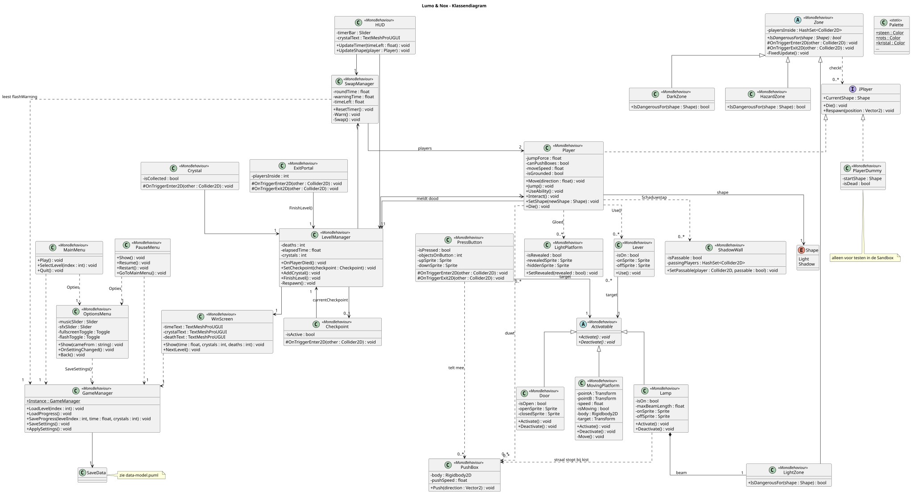
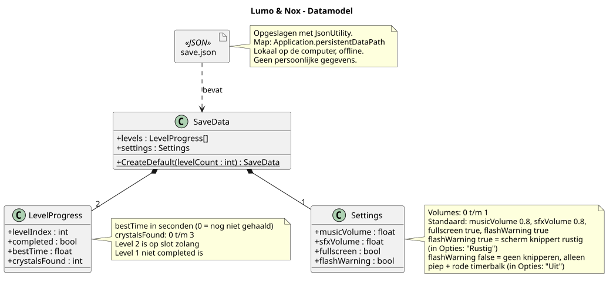

# Klassendiagram en data-model

## Klassendiagram

We maken één klasse `Player`. Lumo en Nox zijn twee spelers met andere instellingen: Lumo heeft een hogere `jumpForce` en Nox heeft `canPushBoxes` aan. Zo hoeven we niets dubbel te schrijven.

Een speler gebruikt een `Lever` met `Interact()`. De `Lever` krijgt dan een `Use()`-aanroep.

Alles wat je aan en uit kunt zetten erft van `Activatable`: `Door`, `Lamp` en `MovingPlatform`. Een `Lever` of `PressButton` kent alleen een `target`. Zo kan één knop later ook iets anders aansturen, zonder dat we de knop aanpassen.

`LightZone`, `DarkZone` en `HazardZone` erven van `Zone`. Ze checken allemaal of een speler in gevaar is, alleen met een andere regel. `HazardZone` is gevaarlijk voor beide vormen (stekels en afgrond).

De `LevelManager` is het centrum van een level. `Player`, `Checkpoint`, `Crystal` en `ExitPortal` roepen hem aan als er iets gebeurt. Hij onthoudt het `currentCheckpoint`, telt doden en kristallen en toont het `WinScreen`. De `SwapManager` kent beide spelers en wisselt hun vorm. De `GameManager` laadt met `LoadProgress()` de `SaveData` (zie het data-model).

`LightPlatform` en `ShadowWall` zijn de puzzel-onderdelen die reageren op de krachten Gloed en Schaduwstap. `HUD`, `MainMenu`, `PauseMenu` en `WinScreen` zijn de schermen. `MainMenu` start het spel of een level via de `GameManager`. We houden het klein, want het is een MVP van 3 weken.

`Palette` bevat de kleuren van Lumo en Nox als vaste waarden, dezelfde als in `tools/generate_tiles.py`. Zo gebruiken scripts (bijvoorbeeld voor licht of de HUD) precies dezelfde kleuren als de graphics.

`OptionsMenu` is te openen vanuit het hoofdmenu en het pauzemenu. `Terug` gaat naar het scherm waar je vandaan kwam. Elke wijziging wordt meteen opgeslagen via `GameManager.SaveSettings()`. Bij het starten laadt de `GameManager` de instellingen en past ze toe met `ApplySettings()`. De `SwapManager` leest `flashWarning` om te bepalen of het scherm mag knipperen bij de wissel.

## Data-model

We slaan twee dingen op in één JSON-bestand (`save.json`) op de eigen computer: de voortgang en de instellingen. JSON is simpel en met `JsonUtility` van Unity zit het er snel in.

- **Voortgang:** per level of het gehaald is, de beste tijd en het aantal kristallen. Daarmee weten we ook of Level 2 open is.
- **Instellingen:** het volume van muziek en geluidseffecten, volledig scherm, en of het scherm mag knipperen bij de wissel. Knipperen staat standaard aan (`flashWarning = true`). Het scherm knippert dan rustig, nooit fel. In Opties kun je het uitzetten voor mensen die gevoelig zijn voor flitsend licht (`flashWarning = false`). Dan hoor je alleen de piep en zie je de rode timerbalk.

We bewaren geen persoonlijke gegevens, dus het spel blijft offline.
