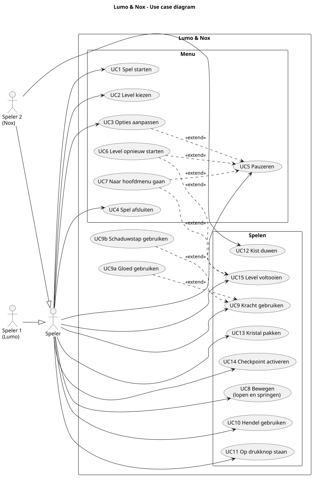

# Use cases

## Use case diagram

## Actoren

- **Speler:** iemand die het spel speelt. Beide spelers kunnen alles, behalve het duwen van kisten.
- **Speler 1 (Lumo):** speelt met A/D/W/S/E.
- **Speler 2 (Nox):** speelt met de pijltjes en Rechter Shift. Alleen Nox kan kisten duwen.

De wissel van vorm is geen use case. Die gebeurt vanzelf (zie [activiteitendiagram 01](activiteitendiagrammen/png/01_wissel.png)).

## Overzicht

| Nr | Use case | Actor |
| --- | --- | --- |
| UC1 | Spel starten | Speler |
| UC2 | Level kiezen | Speler |
| UC3 | Opties aanpassen | Speler |
| UC4 | Spel afsluiten | Speler |
| UC5 | Pauzeren | Speler |
| UC6 | Level opnieuw starten | Speler |
| UC7 | Naar hoofdmenu gaan | Speler |
| UC8 | Bewegen (lopen en springen) | Speler |
| UC9 | Kracht gebruiken (UC9a Gloed, UC9b Schaduwstap) | Speler |
| UC10 | Hendel gebruiken | Speler |
| UC11 | Op drukknop staan | Speler |
| UC12 | Kist duwen | Nox |
| UC13 | Kristal pakken | Speler |
| UC14 | Checkpoint activeren | Speler |
| UC15 | Level voltooien | Speler |

## Beschrijvingen

### UC1 Spel starten

- **Voorwaarde:** we zijn in het hoofdmenu.
- **Verloop:** de speler kiest Spelen. Het spel laadt het eerste level, of het eerstvolgende level dat nog niet gehaald is.
- **Resultaat:** het level start met beide spelers bij het startpunt.

### UC2 Level kiezen

- **Voorwaarde:** we zijn in het hoofdmenu.
- **Verloop:** de speler opent Level select en kiest een level.
- **Resultaat:** het gekozen level start.

### UC3 Opties aanpassen

- **Voorwaarde:** we zijn in het hoofdmenu of het pauzemenu.
- **Verloop:** de speler past het volume, volledig scherm of het knipperen aan. De besturing kunnen we alleen bekijken.
- **Resultaat:** de instelling werkt meteen en wordt lokaal opgeslagen. Terug gaat naar het scherm waar we vandaan kwamen.

### UC4 Spel afsluiten

- **Voorwaarde:** we zijn in het hoofdmenu.
- **Verloop:** de speler kiest Afsluiten.
- **Resultaat:** het spel sluit af.

### UC5 Pauzeren

- **Voorwaarde:** we spelen een level.
- **Verloop:** een speler drukt op Esc. Het spel wordt wazig, de HUD verdwijnt en de wissel-timer staat stil. Esc of Verder zet het spel weer aan.
- **Resultaat:** het pauzemenu is open, met de keuzes Verder, Opnieuw, Opties en Hoofdmenu (zie [activiteitendiagram 09](activiteitendiagrammen/png/09_pauze.png)).

### UC6 Level opnieuw starten

- **Voorwaarde:** het pauzemenu of het winscherm is open.
- **Verloop:** de speler kiest Opnieuw.
- **Resultaat:** het level begint vanaf het begin. Tijd, kristallen en doden staan weer op 0.

### UC7 Naar hoofdmenu gaan

- **Voorwaarde:** het pauzemenu of het winscherm is open.
- **Verloop:** de speler kiest Hoofdmenu.
- **Resultaat:** het hoofdmenu laadt. Na een pauze vervalt de voortgang van dit level.

### UC8 Bewegen

- **Voorwaarde:** we spelen een level.
- **Verloop:** de speler loopt en springt met zijn eigen toetsen.
- **Alternatief:** de speler komt in een gevaarlijke zone (bijvoorbeeld een lichtstraal in schaduw-vorm). Dan gaan we allebei terug naar het laatste checkpoint en telt de dood mee (zie [activiteitendiagram 02](activiteitendiagrammen/png/02_doodgaan_respawn.png)).
- **Resultaat:** het figuur staat op een nieuwe plek.

### UC9 Kracht gebruiken

- **Voorwaarde:** we spelen een level.
- **Verloop:** de speler drukt op S of pijltje omlaag. De kracht hangt af van de huidige vorm:
  - **UC9a Gloed** (licht-vorm): lichtplatforms worden zichtbaar en betreedbaar.
  - **UC9b Schaduwstap** (schaduw-vorm): het figuur loopt door schaduwmuren heen.
- **Resultaat:** de speler kan een plek bereiken die anders dicht zit. Na de wissel hoort de kracht bij de nieuwe vorm.

### UC10 Hendel gebruiken

- **Voorwaarde:** de speler staat bij een hendel.
- **Verloop:** de speler drukt op E of Rechter Shift.
- **Resultaat:** de lamp of deur die bij de hendel hoort gaat aan of uit (zie [activiteitendiagram 06a](activiteitendiagrammen/png/06a_hendel.png)).

### UC11 Op drukknop staan

- **Voorwaarde:** er ligt een drukknop in het level.
- **Verloop:** de speler gaat op de knop staan en blijft staan.
- **Resultaat:** de deur is open zolang iemand op de knop staat (zie [activiteitendiagram 06b](activiteitendiagrammen/png/06b_drukknop.png)). De ander kan er zo doorheen.

### UC12 Kist duwen

- **Voorwaarde:** de speler is Nox en staat naast een kist.
- **Verloop:** Nox loopt tegen de kist aan.
- **Resultaat:** de kist schuift. Zo kan hij een lichtstraal blokkeren en schaduw maken (zie [activiteitendiagram 05](activiteitendiagrammen/png/05_kist_duwen.png)).

### UC13 Kristal pakken

- **Voorwaarde:** het kristal ligt nog in het level.
- **Verloop:** de speler loopt tegen het kristal aan.
- **Resultaat:** de teller gaat omhoog (bijvoorbeeld 1/3). Kristallen zijn optioneel en tellen mee voor de score.

### UC14 Checkpoint activeren

- **Voorwaarde:** het level heeft een checkpoint (lantaarn).
- **Verloop:** we lopen er allebei langs.
- **Resultaat:** de lantaarn gaat branden. Dit is nu ons respawnpunt en de wissel-timer begint daar opnieuw.

### UC15 Level voltooien

- **Voorwaarde:** we spelen een level.
- **Verloop:** beide spelers staan tegelijk in het uitgangsportaal.
- **Resultaat:** het winscherm toont tijd, kristallen en doden. De voortgang wordt opgeslagen. Daarna kunnen we naar het volgende level, opnieuw spelen (UC6) of naar het hoofdmenu (UC7).
