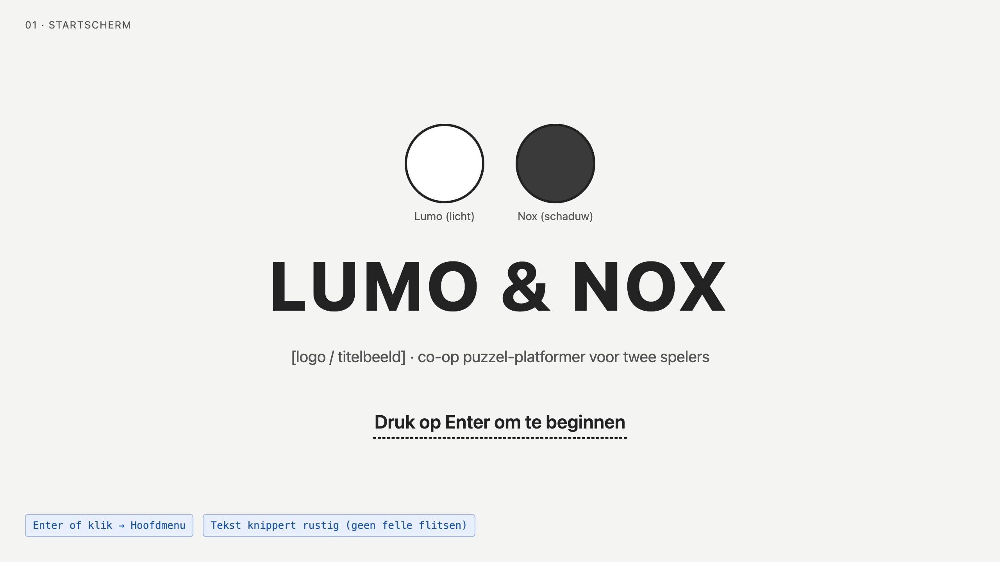
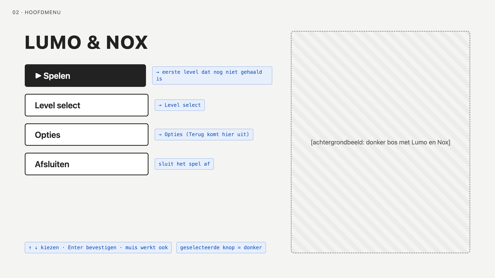
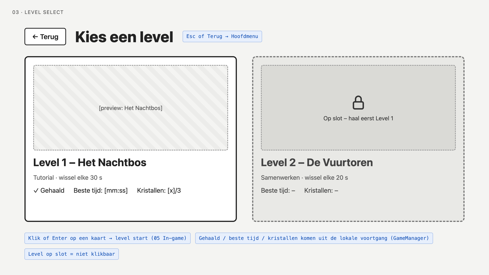
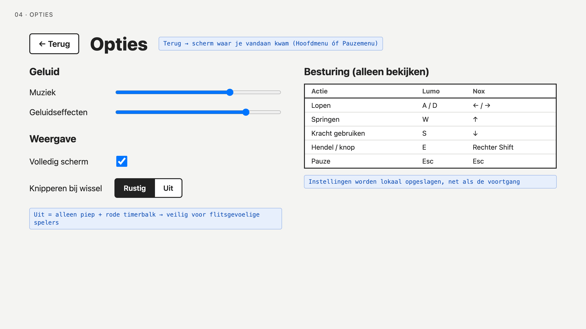
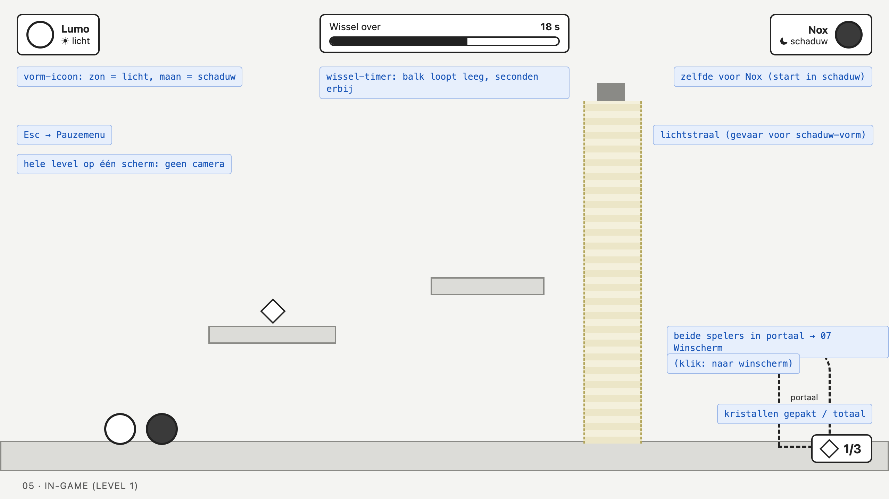
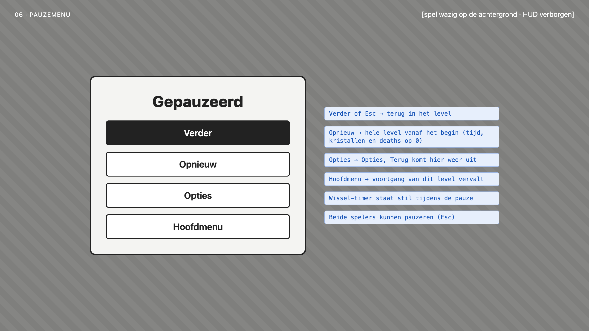
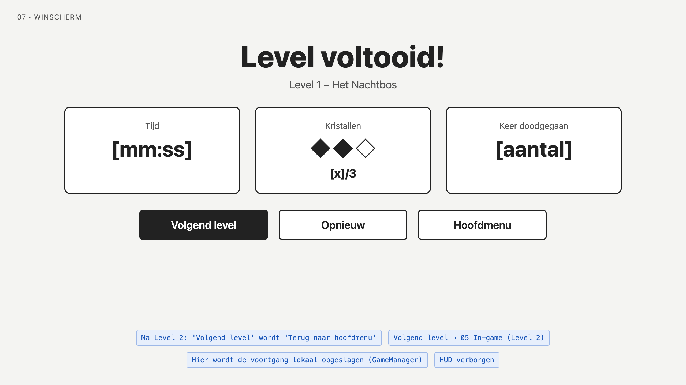
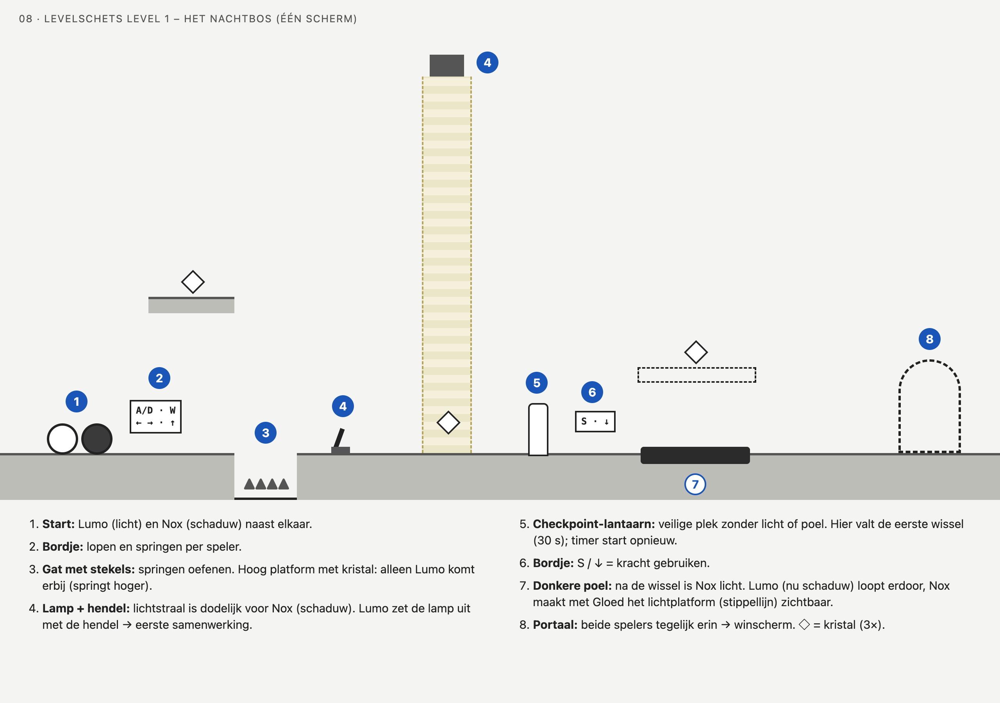

# Wireframes

Dit zijn de schermen van het spel en de levelschets van Level 1.

## 01 Startscherm

Het eerste scherm met de titel. Met een toets gaan we naar het hoofdmenu.

## 02 Hoofdmenu

Het centrum van het spel: spelen, level select, opties of afsluiten.

## 03 Level select

Hier kiezen we welk level we spelen.

## 04 Opties

Hier stellen we geluid en weergave in en zien we de besturing.

## 05 In-game + HUD

Het level met de HUD: de vorm van Lumo en Nox, de wissel-timer en het aantal kristallen.

## 06 Pauzemenu

Met Esc pauzeren we het spel. Van hier gaan we verder, opnieuw, naar opties of naar het hoofdmenu.

## 07 Winscherm

Dit zien we als beide spelers in het portaal staan: volgend level, opnieuw of hoofdmenu.

## 08 Levelschets – Het Nachtbos

De opbouw van Level 1 op één scherm, met genummerde stappen van start tot portaal.
